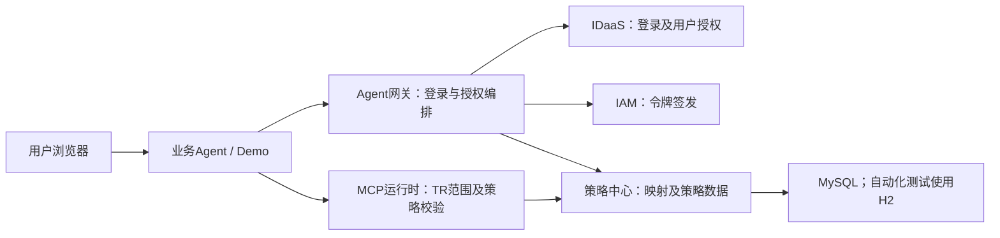

# Agent网关与策略中心系统设计验证报告

整理及本地验证日期：2026-10-16。证据基线：`f052aa7`。能力对应：软件设计能力。

本人负责两个正式服务的模块设计和验证。本报告根据现有设计、代码、本地自动化执行结果补充整理，不作为历史设计评审纪要。验证目标是确认关键架构选择能够落实到模块行为，并识别尚未完成验证的风险。

## 1. 设计范围与架构

| 模块 | 已实现职责 | 边界 |
| --- | --- | --- |
| Agent网关 | 登录授权编排、Agent信息查询、订阅校验、IDaaS/IAM适配、短事务与票据 | 不维护业务用户长期登录态，不执行最终工具策略裁决 |
| 策略中心 | 权限点、工具映射、订阅快照和策略的持久化、查询与生命周期管理 | 提供策略数据，不承担真实MCP网关最终裁决 |
| Demo业务Agent | 本地会话、TR缓存、授权回跳恢复、Mock工具运行时验证 | 是测试与演示应用，不是外部MCP生产系统 |

图中MCP运行时在本次本地验证中由Demo内的Mock替代；测试未同时启动并连接所有真实系统。

## 2. 识别的关键系统设计问题

| 编号 | 问题及影响 | 设计选择 | 当前验证结果 |
| --- | --- | --- | --- |
| D-01 | 回跳URL直接交付身份或令牌，会扩大浏览器历史、代理日志及Referer中的暴露面 | base交付`ticketST`，授权交付`token_result_ticket`，由后端交换结果 | 主流程可完成两类交换，顺序重复使用失败；对URL构建进行了代码检查 |
| D-02 | 将申请权限点当成用户实际同意范围，会使部分授权的语义失真 | Tc实际`consented_scopes`为授权来源，缺少有效范围时不继续业务授权 | Tc字符串数组解析和缺失范围拒绝测试通过；部分同意端到端场景待补 |
| D-03 | 全局工具映射携带Agent维度，容易与Agent用户策略耦合 | resolve接口不带Agent；策略查询保留`agentId` | 双向映射及有效策略查询通过；Demo验证按Agent执行策略 |
| D-04 | 工具需求超出Agent注册订阅，却继续发起用户授权 | 在创建授权事务前检查所需权限点是否全部订阅 | 未订阅所需权限点的资源令牌申请返回403 |
| D-05 | 停用和硬删除后留下运行时脏引用 | 状态过滤与事务级联删除并存，清理订阅快照及关联数据，保留工具主表 | 停用、恢复、级联清理、共享工具保留及重复删除测试通过 |
| D-06 | 外部环境未就绪导致本地开发无法验证 | 外部client端口分离，mock/real可配置，MCP模拟独立开关 | 本地Mock主流程、real客户端HTTP契约和模式选择测试通过 |
| D-07 | TR真实字段变化导致用户、Agent及授权范围解析错误 | 权限点从`agency_user.consented_scopes`读取，用户从`user`字符串的`uid`读取，Agent从`aud`读取 | 真实形状的合成载荷、预留scope不参与授权、Agent不匹配等测试通过 |

## 3. 验证方法与结果

2026-10-16在Windows、Java 21.0.10、Maven 3.9.14环境执行根工程`mvn -q test`，退出码为0，三个应用共53个测试全部通过。详细套件结果和方法名见[开发者测试报告](./04_开发者测试与自动化验证报告.md)。

| 验证项 | 方法及主要证据 | 已验证结论 |
| --- | --- | --- |
| V-01：登录和授权结果交付 | `AgentGatewayFlowTest.shouldCompleteBaseLoginAndConsentWithOneTimeTickets` | Mock环境可完成登录、用户信息交换、授权、TR交换及顺序重复消费拒绝 |
| V-02：授权来源 | `RealIdaasTokenClientTest`的Tc解析和缺失范围测试 | 客户端读取实际Tc范围，不以本地申请集合补齐 |
| V-03：注册能力边界 | `AgentGatewayFlowTest.shouldRejectResourceTokenWhenPermissionPointIsNotSubscribed` | 网关会拒绝超出Agent订阅的权限点申请 |
| V-04：策略数据及删除完整性 | `PolicyResolutionControllerTest`的21个H2集成测试 | 正常写入、查询、状态变更、订阅快照及硬删除行为可执行 |
| V-05：运行时拒绝路径 | `MockMcpGatewayClientTest`的6个测试 | TR、Agent、策略、工具覆盖条件均参与判断，策略放行不能补足TR缺失权限 |
| V-06：外部调用协议 | IDaaS、IAM和Agent管理面HTTP模拟测试 | 可验证路径、请求格式、认证头、字段映射及部分错误处理 |

数据库测试经过真实Controller、Service和MyBatis访问H2；HTTP模拟测试验证客户端契约，不连接真实服务。53个测试通过是功能样本结果，不是覆盖率或系统级安全认证结论。

## 4. 仍需验证的设计问题

| 编号 | 观察或限制 | 后续验证要求 |
| --- | --- | --- |
| L-01 | 票据使用`find`与`delete`两个操作，当前用例只验证顺序重复使用 | 验证同票据并发交换，评估原子消费；不得据现有结果宣称并发防重放完成 |
| L-02 | Caffeine短事务与票据为进程内数据，当前TTL配置为5分钟 | 验证过期、重启丢失和多实例回调路由；部署扩容前明确共享存储或路由方案 |
| L-03 | Demo TR解析器只做载荷解析，Mock测试不验真实IAM签名 | 真实MCP需另行验证签名、发行方、时效和受众；`aud`字段匹配不能代替验签 |
| L-04 | 策略中心无映射查询可返回空数组 | 调用方需明确未知工具、部分缺映射的拒绝语义，增加跨模块回归，防止空集合被当作已授权 |
| L-05 | H2兼容模式不能完全代表MySQL 5.7 | 在目标库验证SQL、字符集、索引、事务及并发，提供真实库联调记录 |
| L-06 | 多表方法有事务注解，现有测试主要验证正常结果 | 补中途故障回滚、快照并发覆盖和跨企业误操作测试 |
| L-07 | 回跳地址当前主要校验host，业务state的本地绑定需要接入方实现 | 补协议、端口、路径和state异常验证；企业字段条件也不能代替调用方认证 |

这些项用于说明设计验证发现的适用边界，不代表本轮已经实施修复。

## 5. 结论与交付证据

在单进程、本地Mock外部依赖和H2测试库的条件下，现有53个测试支持核心模块行为可执行：票据后端交付、实际授权范围读取、订阅校验、策略数据管理及工具权限限制均有样本验证。真实环境安全性、生产可靠性、性能、多实例及覆盖率仍需专项证据。

可追溯材料：

- [总体方案](../final_design/02_引入Agent网关版方案.md)、[一次性凭据安全约束](../final_design/flow_details/03_one_time_ticket_security.md)、[策略中心设计](../final_design/05_策略中心设计.md)。
- [网关编排代码](../../services/agent-gateway/src/main/java/com/huawei/it/roma/liveeda/auth/service/GatewayAuthService.java)、[订阅校验代码](../../services/agent-gateway/src/main/java/com/huawei/it/roma/liveeda/auth/service/ResourceTokenService.java)。
- [策略中心业务代码](../../services/policy-center/src/main/java/com/huawei/it/roma/policycenter/service/PolicyResolutionService.java)、[Mock MCP代码](../../services/demo-business-agent/src/main/java/com/huawei/it/roma/liveeda/demoagent/service/MockMcpGatewayClient.java)。

待补评审记录：评审日期、参与人、关键意见、处理结果及报告认可依据，详见[证据清单](./06_证据清单与待补材料.md)。
